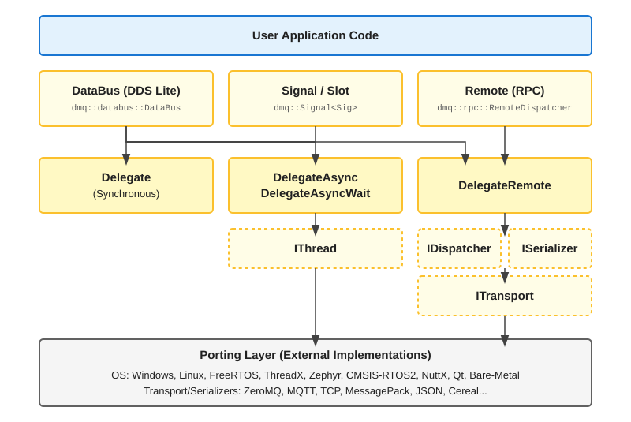

[](https://github.com/DelegateMQ/DelegateMQ/actions/workflows/cmake_ubuntu.yml)
[](https://github.com/DelegateMQ/DelegateMQ/actions/workflows/cmake_windows.yml)
[](https://github.com/DelegateMQ/DelegateMQ/actions/workflows/platformio.yml)


# Delegates in C++

**C++ delegates, signals, remote calls and publish/subscribe, from bare metal to the desktop.**

A delegate is a type-safe wrapper around any callable (free function, member function or lambda) that can be stored and invoked later. DelegateMQ lets you invoke it right here, on another thread, or on another processor, without changing the calling code:

```cpp
#include "DelegateMQ.h"

void MsgOut(const std::string& msg) { std::cout << msg << std::endl; }

int main()
{
    dmq::os::Thread worker("Worker");
    worker.CreateThread();

    auto sync  = dmq::MakeDelegate(&MsgOut);          // runs on the calling thread
    auto async = dmq::MakeDelegate(&MsgOut, worker);  // runs on the worker thread

    sync("Hello");
    async("Hello");   // same call; DelegateMQ copies the argument across threads

    // A multicast delegate holds any number of delegates with the same signature
    // and invokes them all with one call, each on its own thread
    dmq::MulticastDelegate<void(const std::string&)> multicast;
    multicast += sync;
    multicast += async;
    multicast("Hello all");   // runs MsgOut now on this thread, and queues it to the worker

    // A signal is a thread-safe multicast delegate that hands back a connection.
    // Each ScopedConnection keeps its subscriber attached until it is destroyed.
    dmq::Signal<void(const std::string&)> signal;
    auto connSync  = signal.Connect(sync);
    auto connAsync = signal.Connect(async);
    signal("Hello subscribers");   // calls every connected delegate

    // A timer signals its subscribers when it expires, here on the worker thread.
    // Timers fire when Timer::ProcessTimers() is called periodically.
    dmq::util::Timer timer;
    auto connTimer = timer.OnExpired.Connect(dmq::util::MakeTimerDelegate(
        [] { std::cout << "Timer expired" << std::endl; }, worker));
    timer.Start(std::chrono::milliseconds(100));

    // The DataBus distributes data by topic name. Publishers and subscribers
    // don't know about each other; each subscriber picks the thread it runs on.
    auto connTemp = dmq::databus::DataBus::Subscribe<float>("sensor/temp",
        [](float temp) { std::cout << "Temperature: " << temp << std::endl; }, &worker);
    dmq::databus::DataBus::Publish<float>("sensor/temp", 21.5f);
}
```

The same call can run in four places. Only where the delegate is created changes:

| The call runs... | Create it with |
| :--- | :--- |
| here, now | `MakeDelegate(&f)` |
| on another thread | `MakeDelegate(&f, thread)` |
| on another thread, waiting for the result | `MakeDelegate(&f, thread, timeout)` |
| in another process or on another processor | a remote delegate, or a DataBus topic, over a transport |

DelegateMQ is a modular C++17 library with a header-only core, plus optional components you enable only if you need them:

* **Delegates and signals:** synchronous calls with no OS required; asynchronous calls across threads, blocking or fire-and-forget; and thread-safe multicast signals.
* **Remote (RPC):** function calls between processes and processors, over any transport and serializer.
* **DataBus (DDS Lite):** topic-based publish/subscribe across threads, processes and processors, with quality-of-service options.

DelegateMQ runs on any embedded or desktop OS, from bare-metal microcontrollers to Windows and Linux. It is lightweight, unit-tested, and ships as full source code under the MIT license.

# Getting Started

Build and run it in a few commands, on the desktop or on a microcontroller board.

## Quick Start

### Desktop (Windows, Linux)

Clone and build the main delegate application. No third-party libraries needed.

```shell
git clone https://github.com/DelegateMQ/DelegateMQ.git
cd DelegateMQ
cmake -B build
cmake --build build
```

Run the built executable:

```shell
# Windows
build\delegate_app\Debug\delegate_app.exe

# Linux
./build/delegate_app/delegate_app
```

To build and run all the example projects as well, run `build_all.py` from the repository root. It fetches the third-party libraries into `external/`, builds them, then builds and runs every sample and reports pass/fail. Requires Python 3 and Git.

```shell
python3 build_all.py            # --from N resumes at step N
```

### Microcontroller (PlatformIO)

From the clone above, build the example sketch for a board, flash it and watch the serial output. Boards in the example: `esp32dev`, `esp32-c3`, `nucleo_f401re`, `disco_f407vg`, `pico`; `native` runs it on the desktop.

```shell
cd example/platformio/async-delegates
pio run -e esp32dev -t upload -t monitor
```

## Adding DelegateMQ to Your Project

- **CMake:** `FetchContent` or `add_subdirectory()`, then `target_link_libraries(app PRIVATE DelegateMQ::DelegateMQ)`. Options such as `DMQ_THREAD` are set in CMake. See [With CMake](docs/BUILD.md#with-cmake).
- **Without CMake (Keil, IAR, STM32CubeIDE, Makefiles):** add `src/delegate-mq` to the include path, put your options in a `DelegateMQConfig.h`, and compile either `src/DelegateMQ.cpp` or every `.cpp` in `src/delegate-mq`. See [Without CMake](docs/BUILD.md#without-cmake).
- **PlatformIO:** add `lib_deps = endurodave/DelegateMQ@^2.4.0`, enable C++17, and put `DelegateMQConfig.h` in `include/`. See [PlatformIO](example/platformio/PLATFORMIO.md).

# Platform Support

Each platform below states how it has been verified. The OS port is selected with a `DMQ_THREAD_*` define; see [BUILD.md](docs/BUILD.md). C++17 is required; RTTI, exceptions and the heap are not (`-fno-rtti`, `-fno-exceptions`, and an optional fixed-block allocator).

| Platform | Port (`DMQ_THREAD_*`) | Verified by | Example |
| :--- | :--- | :--- | :--- |
| Windows (MSVC) | `STDLIB`, `WIN32` | CI: build and unit tests. Test suite: every desktop sample, the `WIN32` port | [test/](test/main.cpp), [os/win32](example/sample-projects/os/win32/README.md) |
| Linux (GCC, Clang) | `STDLIB`, `POSIX` | CI: build, unit tests, sanitizers, stress tests. Test suite: every desktop sample, the `POSIX` port, unit tests on big-endian s390x, 32-bit Arm and 64-bit Arm (AArch64) under QEMU | [test/](test/main.cpp), [os/posix](example/sample-projects/os/posix/README.md) |
| FreeRTOS | `FREERTOS` | CI: Cortex-M4 compile. Test suite: POSIX and Win32 simulators; Cortex-M3 under QEMU with a hardware interrupt; ESP32 (dual-core Xtensa, ESP-IDF) under QEMU with a hardware interrupt. Board: STM32F4 Discovery | [os/freertos](example/sample-projects/os/freertos/README.md), [os/freertos-bare-metal](example/sample-projects/os/freertos-bare-metal/README.md), [os/freertos-esp32](example/sample-projects/os/freertos-esp32/README.md), [boards/stm32-freertos](example/sample-projects/boards/stm32-freertos/README.md), [pumptron](example/pumptron/PUMPTRON.md), [cellutron](example/cellutron/CELLUTRON.md) |
| ESP32, ESP32-C3, ESP32-S3, STM32F4 Discovery (Arduino) | `FREERTOS` | CI: PlatformIO build. Board: STM32F4 Discovery | [platformio](example/platformio/PLATFORMIO.md) |
| ThreadX | `THREADX` | CI: Cortex-M4 compile. Test suite: Linux simulator, with NetX Duo networking | [os/threadx](example/sample-projects/os/threadx/README.md), [transport/netx-udp](example/sample-projects/transport/netx-udp/README.md) |
| CMSIS-RTOS2 | `CMSIS_RTOS2` | CI: Cortex-M4 compile. Test suite: Zephyr `native_sim`; Cortex-M3 under QEMU with a hardware interrupt | [os/cmsis-rtos2](example/sample-projects/os/cmsis-rtos2/README.md) |
| Zephyr | `ZEPHYR` | Test suite: `native_sim`; Cortex-M3 under QEMU | [os/zephyr](example/sample-projects/os/zephyr/README.md), [databus/zephyr](example/sample-projects/databus/zephyr/README.md) |
| NuttX | `NUTTX` | Test suite: NuttX `sim` | [os/nuttx](example/sample-projects/os/nuttx/README.md) |
| Qt | `QT` | CI: Linux build and tests. Test suite: Linux | [os/qt](example/sample-projects/os/qt/README.md) |
| Bare metal: Cortex-M, RISC-V | `NONE` | Test suite: Cortex-M0, M3, M4, M33 and RISC-V (RV32) under QEMU, with hardware timer interrupts | [bare-metal/qemu](example/sample-projects/bare-metal/qemu/README.md) |
| STM32 Nucleo, RP2040 (Arduino) | `NONE` (synchronous only) | CI: PlatformIO build | [platformio](example/platformio/PLATFORMIO.md) |
| Desktop via PlatformIO | `STDLIB` | CI: PlatformIO build and run | [platformio](example/platformio/PLATFORMIO.md) |

**CI** runs on every push (GitHub Actions; see Build Status below). The **test suite** is `build_all.py --full`, run on Windows and on Linux in Docker: it builds and runs every sample listed, the simulators and QEMU targets included (see [Full Test Suite](docs/BUILD.md#full-test-suite---full)). **Board** entries were run by hand on real hardware.

## Build Status

| Build | Status |
| :--- | :--- |
| Ubuntu (GCC, coverage) | [](https://github.com/DelegateMQ/DelegateMQ/actions/workflows/cmake_ubuntu.yml) |
| Clang | [](https://github.com/DelegateMQ/DelegateMQ/actions/workflows/cmake_clang.yml) |
| Windows (MSVC) | [](https://github.com/DelegateMQ/DelegateMQ/actions/workflows/cmake_windows.yml) |
| Embedded config (allocator, asserts) | [](https://github.com/DelegateMQ/DelegateMQ/actions/workflows/cmake_embedded.yml) |
| Sanitizers | [](https://github.com/DelegateMQ/DelegateMQ/actions/workflows/cmake_sanitizers.yml) |
| Stress tests | [](https://github.com/DelegateMQ/DelegateMQ/actions/workflows/cmake_stress.yml) |
| RTOS ports compile (FreeRTOS, ThreadX, CMSIS-RTOS2) | [](https://github.com/DelegateMQ/DelegateMQ/actions/workflows/embedded_ports_compile.yml) |
| Qt port (Linux) | [](https://github.com/DelegateMQ/DelegateMQ/actions/workflows/qt.yml) |
| PlatformIO boards | [](https://github.com/DelegateMQ/DelegateMQ/actions/workflows/platformio.yml) |

# Motivation

Applications typically use one mechanism for callbacks, another for inter-thread messaging, and a third for inter-processor communication. Each brings its own API and data-passing rules, plus the hand-written queues, mutexes and message-packing code to go with it. Yet all three solve the same problem: move argument data to a target function and invoke it. DelegateMQ handles the copying, marshalling and dispatch in one library, and the calling code stays the same.

# Advantages

Why choose DelegateMQ over a callback, signal/slot, or messaging library.

| Advantage | Description |
| --- | --- |
| One invocation model | Sync, async, and remote calls use the same calling code — moving a local callback onto another thread is a one-line change, and onto another processor needs only a channel. |
| Targeted thread dispatch | Handlers specify the thread they run on; the library queues and dispatches the call, so code always executes in the correct thread context. |
| Safe with object lifetimes | A delegate bound to an object held by `std::shared_ptr` keeps only a `std::weak_ptr`: an async call that arrives after the object is destroyed is skipped, never run through a dangling pointer. |
| Interrupt to thread | An ISR posts a call that runs later on any thread, with no heap, mutex or blocking in the ISR, on every RTOS and bare metal. |
| Application owns every thread | The library creates no internal threads — scheduling, stack sizes, and watchdogs stay explicit and auditable. |
| Portable worker threads | One `dmq::os::Thread` API on every supported OS, with delegate dispatch, thread priorities (RTOS ports), a priority message queue, queue-full and shutdown policies, start/exit/idle hooks, a start gate for synchronized startup, a watchdog with failure-capture hooks, and error reporting built in. |
| Off-target development | Embedded application logic builds and runs on a Windows or Linux host for testing; moving to hardware swaps only the thread port and transport. |
| Location transparency | DataBus subscribers receive data identically whether the publisher is in the same thread, another process, or a remote processor. |
| Reliable delivery built in | Acknowledgments and retries, duplicate and stale-message filtering, delivery-failure and error signals, queue-full policies and thread watchdogs: the parts of a link that are hardest to get right by hand. See [Hand-Coded Infrastructure](docs/COMPARISON.md#hand-coded-infrastructure). |
| Tested infrastructure | Every mechanism runs in the test suite on every change: unit and stress tests with sanitizers, every RTOS port, QEMU targets and boards (see [Platform Support](#platform-support)). A bug found is fixed once, for every port, with a test to keep it fixed. |
| Less application code | No hand-coded message queues, mutexes or transport plumbing: the library delivers type-safe data to its destination, across threads and processors. |

# Supported Integrations

Numerous platform, serialization, transport, and tool integrations are available out of the box. The OS, serializer, and transport integrations form the **DelegateMQ Abstraction Layer** (`src/delegate-mq/port`), which sits between the library and the platform (see the [layer diagram](#overview)); the tools are separate applications built on the library. Adding support for a new OS, serializer, or transport requires only implementing a small pure-virtual interface.

| Category | Supported |
| :--- | :--- |
| **Operating Systems** | Windows, Linux, POSIX, FreeRTOS, ThreadX, Zephyr, CMSIS-RTOS2, NuttX, Qt, Bare-metal (see [Platform Support](#platform-support)) |
| **Build** | [CMake](https://cmake.org/), [PlatformIO](https://platformio.org/), or any build system (Keil, IAR, STM32CubeIDE, Makefiles, ...) |
| **Serialization** | [MessagePack](https://msgpack.org/index.html), [RapidJSON](https://github.com/Tencent/rapidjson), [Cereal](https://github.com/USCiLab/cereal), [Bitsery](https://github.com/fraillt/bitsery), [MessageSerialize](https://github.com/endurodave/MessageSerialize) |
| **Transport** | [ZeroMQ](https://zeromq.org/), [NNG](https://github.com/nanomsg/nng), [MQTT](https://github.com/eclipse-paho/paho.mqtt.c), [Serial Port](https://github.com/sigrokproject/libserialport), TCP, UDP, ARM LwIP, ThreadX NetX/Duo, Zephyr Networking, data pipe, Unix domain socket, memory buffer |
| **Bridges & Tools** | [MQTT gateway](tools/TOOLS.md#json-bridges--jsontopics-and-mqttbridge) (standard MQTT with JSON payloads, for MQTT tools such as [Node-RED](https://nodered.org/), [Home Assistant](https://www.home-assistant.io/) and [Grafana](https://grafana.com/)); [PlotJuggler](https://github.com/facontidavide/PlotJuggler) live plots; [Wireshark](https://www.wireshark.org/) dissector |
| **Logging** | [spdlog](https://github.com/gabime/spdlog) (`DMQ_LOG`) |

# Example Use Cases

- Async callback between a subsystem and the UI
- Blocking call into a worker thread with a timeout, returning its result
- Handing interrupt data (button, DMA, CAN frame) to a worker thread
- Thread-safe wrapper around a non-thread-safe library (database, HTTP client, file system)
- Data distribution between threads and CPUs over Ethernet, serial, or both
- Embedded development on a PC, with the same code running on the target
- C# or Python tools commanding and monitoring an embedded device
- Bridging device data to MQTT as JSON, for dashboards and IoT platforms

# Example Projects

The [example](example/README.md) directory ranges from single-file snippets to complete multi-node applications. Highlights:

| Example | Description | Docs |
| :--- | :--- | :--- |
| **Sample code** | Short, single-file examples of common patterns: active object, observer, producer/consumer, reactor, scatter-gather, signal/slot, remote calls and more. Built into and run by the unit-test app. | [README.md](example/sample-code/README.md) |
| **Sample projects** | Standalone CMake projects, grouped by topic: OS ports (`os/`), bare metal (`bare-metal/`), real boards (`boards/`), transports and serializers (`transport/`), DataBus (`databus/`), a client/server system (`system-architecture/`) and build integration (`integration/`). The [example workspace setup](docs/BUILD.md#example-ecosystem-sandbox) fetches and builds the third-party libraries they need. | [README.md](example/sample-projects/README.md) |
| **Cellutron** | Simulated safety-critical cell processing instrument: GUI, controller and safety nodes as three Windows/Linux processes, the controller and safety nodes on FreeRTOS or ThreadX simulators, linked by a distributed DataBus. | [CELLUTRON.md](example/cellutron/CELLUTRON.md) |
| **Pumptron** | Pump controller on a real STM32F4 Discovery board (FreeRTOS), monitored and commanded from a Windows/Linux console over a serial link using the DataBus. Includes a hardware watchdog and crash dumps delivered to the console. The same controller code also runs on the PC via the FreeRTOS simulator. | [PUMPTRON.md](example/pumptron/PUMPTRON.md) |

# Overview

DelegateMQ builds everything on one primitive, the delegate: the same delegate that fires a local callback can also dispatch onto a worker thread or a remote processor.

The OS, transport, and serializer sit behind small pure-virtual interfaces, so underlying technologies swap without changing application logic. DelegateMQ's implementations of those interfaces for each supported OS, transport and serializer form the **DelegateMQ Abstraction Layer** (`src/delegate-mq/port`); only the platform beneath it (OS kernels, network stacks, third-party libraries) is external:

<br>
*DelegateMQ Layer Diagram*

## Synchronous Delegates

Synchronous delegates invoke the target function anonymously within the current execution context. No external library or OS dependencies are required.

```cpp
#include "DelegateMQ.h"

size_t MsgOut(const std::string& msg)
{
    std::cout << "[" << std::this_thread::get_id() << "] " << msg << std::endl;
    return msg.size();
}

int main()
{
    // 1. Synchronous Invocation
    auto sync = dmq::MakeDelegate(&MsgOut);
    sync("Invoke MsgOut sync!");
    return 0;
}
```

## Asynchronous Delegates

Asynchronous delegates simplify multithreaded programming by allowing you to invoke functions across thread boundaries safely, without manual locking or queue management.

```cpp
dmq::os::Thread thread("WorkerThread");
thread.CreateThread();

// 1. Asynchronous Invocation (Non-blocking / Fire-and-forget)
auto async = dmq::MakeDelegate(&MsgOut, thread);
async("Invoke MsgOut async (non-blocking)!");

// 2. Asynchronous Invocation (Blocking / Wait for result)
auto asyncWait = dmq::MakeDelegate(&MsgOut, thread, dmq::WAIT_INFINITE);
size_t size = asyncWait("Invoke MsgOut async wait (blocking)!");

// 3. Asynchronous Invocation with Timeout
auto asyncWait1s = dmq::MakeDelegate(&MsgOut, thread, std::chrono::seconds(1));
auto retVal = asyncWait1s.AsyncInvoke("Invoke MsgOut async wait (blocking max 1s)!");
if (retVal.has_value())     // Async invoke completed within 1 second?
    size = retVal.value();  // Get return value
```

### Passing Arguments

The two kinds of asynchronous call treat arguments in opposite ways:

* **Async (fire-and-forget)** copies every argument into the message for the target thread, including the data behind pointers and references. The caller returns at once and can change or free its own data; nothing dangles.
* **Async-wait (blocking)** passes arguments as they are, because the caller waits. The target works on the caller's own variables, so out-parameters and return values work.

| Argument | Async | Async-wait |
| :--- | :--- | :--- |
| `T` | copied | passed as is |
| `T&`, `const T&` | the object is copied; the target gets a reference to the copy | the caller's object |
| `T*`, `T**` | the data pointed to is copied; the target gets a pointer to the copy | the caller's data |
| `std::shared_ptr<T>` | shared, not copied: the way to pass large data without a copy | shared |
| `void*` | rejected at compile time (the data behind it can't be copied) | allowed |
| Out-parameters, return value | not written back; no return value | written back; returned |

Each argument gets its own rule, for any number and mix of arguments. By comparison, `std::thread` and `std::async` copy a pointer argument as just the pointer, so the new thread reads the caller's data, which may already be gone, and they can't run a call on a thread you choose. 

Multiple asynchronous delegates can also be stored in a `dmq::MulticastDelegateSafe` container and invoked as a group — a common pattern for completion callbacks, where each registered callback executes on its own target thread:

```cpp
// Asynchronous Callback Pattern (broadcast to all registered callbacks)
dmq::MulticastDelegateSafe<void(int)> onComplete;
onComplete += dmq::MakeDelegate([](int result) {
    // Callback executed on 'thread'
}, thread);
onComplete(123);
```

`dmq::util::AsyncInvoke` reduces a blocking cross-thread call to one line. A common use is making a class thread-safe: each public method marshals its call onto the class's own thread. If the caller is already on that thread, the function runs directly, so there's no self-deadlock:

```cpp
class Database
{
public:
    Database() : m_thread("DbThread") { m_thread.CreateThread(); }

    // Callable from any thread; InternalWrite() always runs on m_thread
    bool Write(const std::string& key, int value) {
        return dmq::util::AsyncInvoke(this, &Database::InternalWrite, m_thread,
                                      dmq::WAIT_INFINITE, key, value);
    }

private:
    bool InternalWrite(const std::string& key, int value);  // no locks needed

    dmq::os::Thread m_thread;
};
```

## Threads

Asynchronous delegates dispatch onto any object that implements the small `dmq::IThread` interface. There are two ways to provide one:

- <b>Use the built-in <code>dmq::os::Thread</code></b> — a ready-made worker thread with its own message queue, available on every supported OS (described below).
- <b>Implement <code>dmq::IThread</code> on your project's existing thread</b> — if your application already has its own thread or event loop (an RTOS task, a GUI loop, a game loop), implement two methods and DelegateMQ dispatches straight onto it. No need to adopt `dmq::os::Thread`. See [dmq::IThread](docs/PORTING.md#dmqithread) for details.

`dmq::os::Thread` is the built-in worker thread. The same class is available on every supported OS, so application code doesn't change between ports. Each thread owns a message queue; high-priority messages (`dmq::Priority::URGENT`) are dispatched ahead of normal ones.

A thread can bound its queue and choose what happens when it fills (`dmq::FullPolicy`), enable a watchdog, run code on the worker at start, exit and idle, and choose how shutdown treats queued messages (`dmq::ExitPolicy`):

```cpp
// Queue limited to 50 messages; when full, drop new messages instead of faulting
dmq::os::Thread worker("Worker", /*maxQueueSize=*/50, dmq::FullPolicy::DROP);

worker.SetStartHandler(dmq::MakeDelegate([] { /* per-thread setup */ }));
worker.SetDroppedHandler(dmq::MakeDelegate([](size_t depth) { /* report the drop */ }));

worker.CreateThread(std::chrono::seconds(2));   // optional watchdog: fault if the thread stalls > 2 s

// ...

worker.ExitThread();                            // runs queued messages first (ExitPolicy::DRAIN)
// worker.ExitThread(dmq::ExitPolicy::DISCARD); // or discard them for a fast shutdown
```

| Policy | Options |
| --- | --- |
| `dmq::FullPolicy` (queue full) | `FAULT` (default) — fault immediately; `DROP` — discard the message; `TIMEOUT` — wait for space, then drop |
| `dmq::ExitPolicy` (`ExitThread()`) | `DRAIN` (default) — run every queued message, then exit; `DISCARD` — finish the running message, cancel the rest |

To start a group of threads together, give each the same optional `dmq::os::StartGate` with `SetStartGate()`: each is created and ready but processes nothing until `gate.Open()`, so no thread runs while others are still being created or wired up. See [Start Gate](docs/PORTING.md#start-gate-synchronized-start).

On hardware, feed the MCU's watchdog right after `Thread::WatchdogCheckAll()` returns, so a hung thread also resets the board, and set a watchdog hook to record which thread hung and where: see [Hardware Watchdog](docs/PORTING.md#hardware-watchdog).

## Signal / Slot

`dmq::Signal<Sig>` is a thread-safe multicast signal. Emit it like a function call; each connected slot receives the call independently. DelegateMQ signals support both synchronous and asynchronous dispatch, meaning slots can be executed in the caller's context or automatically queued onto a target worker thread chosen at connect time. `Connect()` returns a `dmq::ScopedConnection` that auto-disconnects when it goes out of scope — no manual unsubscribe needed.

Declare the signal as a plain class member — no `shared_ptr` or heap allocation required:

```cpp
class Button
{
public:
    dmq::Signal<void(int buttonId)> OnPressed;  // plain member

    void Press(int id) { OnPressed(id); }       // emit to all connected slots
};
```

Connect a slot and store the `dmq::ScopedConnection` for automatic lifetime management:

```cpp
class UI
{
public:
    UI(Button& btn) : m_thread("UIThread")
    {
        m_thread.CreateThread();

        // Slot dispatched to m_thread on every Press()
        m_conn = btn.OnPressed.Connect(
            dmq::MakeDelegate(this, &UI::HandlePress, m_thread)
        );
    }
    // No explicit disconnect needed — m_conn disconnects when UI is destroyed

private:
    void HandlePress(int buttonId) { std::cout << "Button " << buttonId << "\n"; }

    dmq::os::Thread m_thread;
    dmq::ScopedConnection m_conn;
};

Button btn;
{
    UI ui(btn);
    btn.Press(1);   // UI::HandlePress queued on UIThread
}                   // ui destroyed -> m_conn disconnects
btn.Press(2);       // safe: no subscribers, nothing happens
```

## Timers

`dmq::util::Timer` provides periodic and one-shot callbacks. `OnExpired` is a `dmq::Signal`, so a slot connects the same way as above and can be dispatched onto any worker thread. 

```cpp
dmq::util::Timer heartbeat;

// Timer callback dispatched to 'thread' on every expiration
auto conn = heartbeat.OnExpired.Connect(
    dmq::MakeDelegate([]() { std::cout << "Heartbeat\n"; }, thread)
);

heartbeat.Start(std::chrono::milliseconds(1000));          // periodic
// heartbeat.Start(std::chrono::milliseconds(500), true);  // one-shot

// Drive all timers (e.g. main loop or RTOS task; an ISR only on bare metal)
while (running) {
    dmq::util::Timer::ProcessTimers();
    std::this_thread::sleep_for(std::chrono::milliseconds(10));
}

heartbeat.Stop();
```

For low power or precise timing, a task can instead sleep until the next timer is due (`Timer::GetNextExpiry()`, woken early by `Timer::SetScheduleChangedHandler()` when a sooner one starts), so the CPU wakes only when a timer fires. See "Event-driven processing" in [llms.txt](llms.txt).

## Interrupts

An ISR can't call an async delegate: that allocates a message and takes the thread's mutex. `dmq::util::IsrDelegate` splits the call. `Post()` in the ISR only copies the arguments into a fixed ring slot, and `IsrDelegates::ProcessAll()` calls the target later, from a task or the main loop. With an async target, the call then runs on its thread.

```cpp
// Once, in task context: OnButton() runs on controllerThread
dmq::util::IsrDelegate<void(uint32_t)> onButton(
    dmq::MakeDelegate(&controller, &Controller::OnButton, controllerThread));

void EXTI0_IRQHandler() { onButton.Post(GPIOA->IDR); }   // ISR: copy only, no heap or mutex

dmq::util::IsrDelegates::ProcessAll();                     // task or main loop
```

## Fixed-Block Allocator (Optional)

Build with `DMQ_ALLOCATOR` to route all library allocations through a fixed-block pool instead of the heap. This gives deterministic allocation times and no heap fragmentation. Application code can use the same allocator through `dmq::` aliases. Without `DMQ_ALLOCATOR` they fall back to their `std::` equivalents, so the same source builds either way:

```cpp
class SensorMsg
{
    XALLOCATOR   // new/delete use the fixed-block pool
public:
    float value;
};

dmq::xlist<int> readings;                          // std::list with pool allocator
dmq::xmap<int, dmq::xstring> names;                // std::map, std::string equivalents
auto msg = dmq::xmake_shared<SensorMsg>();         // object and control block from the pool
```

`dmq::xset`, `dmq::xqueue`, and others are also available. See [Fixed-Block Memory Allocator](docs/DETAILS.md#fixed-block-memory-allocator).

# DataBus (DDS Lite)

`dmq::databus::DataBus` is a type-safe, topic-based publish/subscribe system (similar to a lightweight DDS or MQTT) built on DelegateMQ delegates. It works across local threads and remote network nodes alike. Each subscriber specifies the thread that receives its data, so delivery always lands in the correct thread context with no manual queuing or synchronization.

DataBus creates no internal threads and is small enough for embedded targets, unlike full DDS systems. Quality of Service (QoS) options such as Last Value Cache (LVC) deliver the most recent value to new subscribers immediately.

Remote topics travel over any supported transport, such as Ethernet or serial, using any supported serializer. See [Supported Integrations](#supported-integrations).

```cpp
#include "DelegateMQ.h"

// 1. Subscribe to a topic (dispatched to a worker thread)
auto conn = dmq::databus::DataBus::Subscribe<float>("sensor/temp", [](float value) {
    std::cout << "Received temp: " << value << std::endl;
}, &workerThread);

// 2. Publish data to the topic
dmq::databus::DataBus::Publish<float>("sensor/temp", 25.5f);

// 3. Optional: Enable Last Value Cache (LVC)
dmq::databus::QoS qos;
qos.lastValueCache = true;
auto conn2 = dmq::databus::DataBus::Subscribe<int>("status", [](int s) {
    // New subscribers get the last published value immediately
}, &workerThread, qos);
```

# Remote Delegates

Remote delegates send a function call to another process or processor. The call's arguments are serialized and sent over a transport, and the receiver's handler runs as an ordinary function call. Both sides share a message ID.

```cpp
constexpr dmq::DelegateRemoteId TEMPERATURE_ID = 1;

void OnTemperature(float t) { std::cout << "Temp: " << t << "\n"; }

// --- Receiver: bind a handler to the ID ---
dmq::RemoteChannel<void(float)> rx(transport, serializer);
rx.Bind(OnTemperature, TEMPERATURE_ID);
dispatcher.RegisterEndpoint(TEMPERATURE_ID, rx);

// --- Sender: invoke the channel ---
dmq::RemoteChannel<void(float)> tx(transport, serializer, TEMPERATURE_ID);
tx(25.5f);  // serialized, sent, and runs OnTemperature() on the receiver
```

`dispatcher` is a `dmq::rpc::RemoteDispatcher`. It owns the network thread and receive loop, routes each incoming message to the channel registered for its ID, and reports ACK/retry status. Any transport (ZeroMQ, TCP, UDP, serial, ...) and serializer (MessagePack, Cereal, ...) can carry the call. Delivery can be made reliable with acknowledgments and retries (`dmq::util::ReliableTransport`, with a `TransportMonitor` and `RetryMonitor`), or left to a transport that is reliable itself (TCP, ZeroMQ).

# Error Handling

DelegateMQ separates **hard faults** (programming or capacity errors that must stop the system) from **recoverable errors** (runtime conditions the application can handle and continue).

**Hard faults** — out of memory, a full thread queue under `FullPolicy::FAULT`, a watchdog timeout, or an invalid argument. The build selects how they surface:

| Build | Behavior |
| --- | --- |
| Default (desktop) | C++ exceptions: `std::bad_alloc`, `std::invalid_argument`, `std::runtime_error` |
| `DMQ_ASSERTS` (embedded default; automatic when exceptions are disabled) | `dmq::util::FaultHandler()` is called; the default prints and halts. To capture the failure first (a log, a core dump), set `dmq::util::SetFaultHook()`; for a watchdog timeout, `dmq::os::SetWatchdogHook()` gets the hung thread. To replace the handlers, define `DMQ_CUSTOM_FAULT_HANDLER`. See [Capturing the Failure](docs/PORTING.md#capturing-the-failure-watchdog-and-fault-hooks). |

**Recoverable errors** — serialization failures, dispatch failures and transport receive errors are reported as a `dmq::DelegateError` code through a handler or signal. On builds with exceptions enabled, a remote error with no handler registered throws `std::runtime_error` (or is stored in `GetError()` when `DMQ_ASSERTS` is defined or exceptions are disabled), so always register one:

```cpp
// Per remote channel
channel.SetErrorHandler(dmq::MakeDelegate(
    [](dmq::DelegateRemoteId id, dmq::DelegateError err, dmq::DelegateErrorAux aux) {
        std::cerr << "Remote " << id << " error " << (int)err << "\n";
    }));

// All channels registered with a RemoteDispatcher
auto errConn = dispatcher.OnError.Connect(dmq::MakeDelegate(
    [](dmq::DelegateRemoteId id, dmq::DelegateError err, dmq::DelegateErrorAux aux) { /* ... */ }));

// DataBus-wide (type mismatches, serializer errors, capacity limits)
auto busConn = dmq::databus::DataBus::SubscribeError(
    [](const dmq::xstring& topic, dmq::DelegateError err) { /* ... */ });
```

# DelegateMQ Tools

DelegateMQ includes three diagnostic TUI (Terminal User Interface) consoles for real-time monitoring of DataBus traffic, network topology, and thread performance. Monitoring runs through an asynchronous bridge and never blocks the application. Built with FTXUI, the consoles run cross-platform in any terminal and support topic filtering for traffic analysis:

| Tool | Purpose |
|------|---------|
| <b><code>dmq-spy</code></b> | Real-time live feed of all DataBus messages — acts as a "Software Logic Analyzer" |
| <b><code>dmq-monitor</code></b> | Live network topology view — shows all active nodes, status, uptime, and published topics |
| <b><code>dmq-thread</code></b> | Performance dashboard — monitors thread health, queue depths, and dispatch latency (Avg/Max) |

The tools also integrate with two popular third-party analyzers:

| Integration | Purpose |
|-------------|---------|
| **Wireshark** | A Lua dissector plugin (`tools/wireshark/dmq.lua`) decodes DelegateMQ UDP/TCP traffic in [Wireshark](https://www.wireshark.org/): header fields, ACKs, and per-project topic labels, with Wireshark's filters and statistics |
| **PlotJuggler** | `dmq-spy --plotjuggler` streams numeric DataBus values to [PlotJuggler](https://github.com/facontidavide/PlotJuggler) for live time-series plots |

See [Tools](tools/TOOLS.md) for setup and usage.


# FAQ

**Why would I use DelegateMQ?**  
To simplify multi-threaded and multi-processor application development:

- **One way to call a function**, whether it runs on the same thread, another thread, or another processor.
- **Less code:** no hand-written queues, mutexes or message packing.
- **Portable:** the same application code runs on Windows, Linux and embedded RTOS targets.

**Is the DelegateMQ library modular?**  
Yes. Start with the header-only delegates and signals (async calls add your OS's thread port). Remote calls (RPC), the DataBus, and the fixed-block allocator are optional; enable them only if you need them.

<b>Do I have to use <code>dmq::os::Thread</code>?</b>  
No. Implement the two-method `dmq::IThread` interface on your existing thread or event loop and dispatch onto it directly. See [dmq::IThread](docs/PORTING.md#dmqithread).

**Why use the DelegateMQ DataBus?**  
For type-safe publish/subscribe that works the same between threads, processes and processors, so components don't need to know where their data comes from. Each subscriber chooses the thread it runs on, and it's small enough for microcontrollers. It runs over any transport, such as Ethernet or a serial link. See [DataBus](docs/DATABUS.md) and [Comparison](docs/COMPARISON.md).

**What network topologies are supported?**  
Any: point-to-point, star, mesh, broadcast/multicast, or broker-based. A topology is just which nodes connect to which. Relay nodes bridge between transports, for example UART to Ethernet. See [Topologies](docs/DATABUS.md#topologies).

**Can C# or Python talk to it?**  
Yes, through a shared native core with C# and Python wrappers. See [Cross-Language Interop](docs/INTEROP.md).

**Is DelegateMQ tested?**  
Yes. Extensive unit and stress tests run in CI on Windows and Linux (GCC, Clang, MSVC), with code coverage and address, thread and undefined-behavior sanitizers. CI also cross-compiles the RTOS ports for ARM Cortex-M, builds and runs the Qt port's test suite, and builds the PlatformIO example for each board. 

# Documentation

| Guide | Description | Key Focus |
| :--- | :--- | :--- |
| [**Tutorial**](docs/TUTORIAL.md) | Step-by-step system evolution | Adoption & Use Cases |
| [**Application Guide**](docs/APP-GUIDE.md) | Rules for writing an app with DelegateMQ (also for coding agents) | Setup, Threads, Shutdown Order |
| [**Build**](docs/BUILD.md) | Build & configuration guide | CMake & Setup |
| [**PlatformIO**](example/platformio/PLATFORMIO.md) | Arduino and PlatformIO boards | ESP32, STM32, Pico, Setup |
| [**Signals**](docs/SIGNALS.md) | Decoupled event handling | Signal/Slot RAII |
| [**DataBus**](docs/DATABUS.md) | Topic-based pub/sub middleware | DDS Lite & Networking |
| [**Design Details**](docs/DETAILS.md) | Deep technical architecture | API Reference |
| [**Porting Guide**](docs/PORTING.md) | OS & Hardware abstraction | Platform Support |
| [**Interop**](docs/INTEROP.md) | Multi-language integration | C# & Python |
| [**Tools**](tools/TOOLS.md) | Diagnostic TUI dashboards and integrations | Spy, Monitor, Wireshark, PlotJuggler |
| [**Comparison**](docs/COMPARISON.md) | Middleware benchmarks | Tradeoff Analysis |
| [**Safety Notes**](docs/SAFETY.md) | Informational MISRA-style self-assessment | Not a certified/compliant standard |

# Other Projects Using DelegateMQ

Repositories built on DelegateMQ.

| Project | Description |
| :--- | :--- |
| [Integration Test Framework](https://github.com/DelegateMQ/IntegrationTestFramework) | Multi-threaded C++ integration test framework using Google Test. |
| [Active-Object State Machine in C++](https://github.com/DelegateMQ/active-fsm) | Active-object finite state machine with RAII-safe asynchronous dispatch and pub/sub signals. |
| [Device Params in C++](https://github.com/DelegateMQ/device-params) | Typed device parameters for embedded C++: range checks, change notification, power-loss-safe persistence (flash, file, SQLite) and remote get/set. |
| [Async-SQLite](https://github.com/DelegateMQ/Async-SQLite) | Thread-safe asynchronous wrapper for SQLite. |
| [Async-DuckDB](https://github.com/DelegateMQ/Async-DuckDB) | Thread-safe asynchronous wrapper for DuckDB. |
| [Async-HTTP](https://github.com/DelegateMQ/Async-HTTP) | Thread-safe asynchronous HTTP client wrapper. |

# History

DelegateMQ is the result of more than two decades of delegate implementations, starting with C++03. C++17 features such as variadic templates and template metaprogramming finally made it possible to express asynchronous delegates concisely and generically on any platform.

Earlier delegate libraries and other portable C/C++ libraries for state machines, callbacks, threading, memory allocation, communication, and testing are collected in [Portable C/C++ Libraries](https://github.com/endurodave/portable-c-cpp-libs).